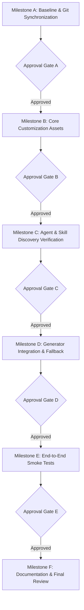

# AI-Coding-starter Upgrade Plan — Detailed Verification Specification

> **Baseline Status**: Working tree on local `master` at commit `1b47280fa223d0ce2b741e9058e91ba32d3e57a9`. Read-only compliance maintained; no repository code modified.

---

## 1. Repository Baseline & Git History Reconciliation

### 1.1 Verified Git Status
* **Repository Root**: `D:\AI-Coding-starter` (verified via `git rev-parse --show-toplevel`).
* **Active Branch**: `master` (verified via `git branch --show-current`).
* **Current Local Commit**: `1b47280fa223d0ce2b741e9058e91ba32d3e57a9`
  * Message: `feat: Generate newProject.bat in the current directory, update setup instructions, and add the generated script to .gitignore.`
* **Remote Tracking Target**: `origin/master` at `d7fac14bfea6152d5cd3867f90bc80a294787e09`
* **Commit Count Difference**: `0 4` (0 ahead, 4 behind).
* **Working Tree State**: Clean (`git status --porcelain=v1` is empty; 0 staged, 0 unstaged, 0 stashes).
* **Ignored Cache / Artifacts**: `newProject.bat` and `__pycache__/` are ignored by `.gitignore`.

### 1.2 Exact Linear Ancestry Graph
Verification via `git log --graph --oneline --decorate -5 origin/master` and parent hash inspection (`git log --format="%h %p %s" -5 origin/master`) confirms a strict linear history without branching divergence:

```text
* d7fac14 (origin/master, origin/HEAD) feat: add support for existing template directories and template updates in setup script
|   Parent: 9f56f6d
* 9f56f6d feat: add project initialization script and configuration file for project setup
|   Parent: 013785e
* 013785e feat: implement dynamic path configuration via config.json and update setup script for user-defined workspace directories
|   Parent: bc6c080
* bc6c080 feat: enable selection of up to 3 tech stack presets with automatic merging logic
|   Parent: 1b47280
* 1b47280 (HEAD -> master) feat: Generate newProject.bat in the current directory, update setup instructions, and add the generated script to .gitignore.
```

### 1.3 Synchronization Safeguard
* **Target Commit**: Fast-forward destination is strictly `origin/master` (`d7fac14bfea6152d5cd3867f90bc80a294787e09`).
* **Approval Requirement**: No Git branch synchronization (`git merge --ff-only origin/master`) will be executed until explicitly approved in Milestone A.

---

## 2. Environment & Runtime Inventory

* **Python Runtime**: `Python 3.11.9` is installed and operational via `python`. (`py -3` is currently broken due to an invalid Python 3.13 registry pointer).
* **Syntax Compilation**: `python -m py_compile new_project.py analytics.py` exits with code 0 (verified).
* **Existing Test Suite**: **None**. No `tests/` directory, no `test_*.py` files, and no test configuration files exist. Baseline test discovery (`python -m unittest discover -v`) records **0 tests ran**.
* **Third-Party Tooling**: `pytest`, `ruff`, `flake8`, `mypy`, and `black` are **not installed** in the Python 3.11 environment.
* **Core Test Strategy**: All automated tests in this upgrade will use Python standard library modules (`unittest`, `json`, `pathlib`, `re`, `py_compile`) so verification runs immediately without unauthorized package installation.

---

## 3. Architecture & Target Directory Layout

The upgrade transforms `AI-Coding-starter` into a modern, self-contained Antigravity workspace structure using the `.agents/` standard:

```text
D:\AI-Coding-starter\
├── .agents/
│   ├── agents/                     # Domain Specialist Custom Agents
│   │   ├── planner.md              # Project Planner / Architect
│   │   ├── ui-ux-designer.md       # UI/UX Designer
│   │   ├── frontend-engineer.md    # Frontend Engineer
│   │   ├── backend-engineer.md     # Backend Engineer
│   │   ├── qa-engineer.md          # QA Engineer
│   │   ├── code-reviewer.md        # Independent Code Reviewer
│   │   ├── database-specialist.md  # Optional Database Specialist
│   │   └── security-reviewer.md    # Optional Security Specialist
│   ├── skills/                     # Modular Agent Skills (Progressive Disclosure)
│   │   ├── status/SKILL.md         # Project status inspector
│   │   ├── progress/SKILL.md       # Progress updater for CONTEXT.md
│   │   ├── fix/SKILL.md            # Self-healing diagnostics & error recovery
│   │   ├── commit/SKILL.md         # Conventional commit generator
│   │   ├── deploy/SKILL.md         # Multi-provider deployment guides
│   │   ├── stats/SKILL.md          # Analytics dashboard runner
│   │   ├── frontend-design/SKILL.md# Design system & responsive UI specifications
│   │   └── code-review/SKILL.md    # Independent review rubric and gates
│   ├── rules/                      # Contextual & Global Rules
│   │   ├── quality-gates.md        # trigger: always_on (verification standards & stop rules)
│   │   ├── git-hygiene.md          # trigger: model_decision (branching & commit safety)
│   │   └── frontend-standards.md   # trigger: glob (UI/UX, accessibility, no unapproved styles)
│   ├── workflows/                  # Original workflows preserved intact
│   │   ├── status.md
│   │   ├── progress.md
│   │   ├── fix.md
│   │   ├── commit.md
│   │   ├── deploy.md
│   └── stats.md
│   └── CONTEXT.md                  # Root Project Context & Memory
├── template_assets/                # Bundled template assets for offline generator provisioning
│   ├── agents/                     # Master copies of agent templates
│   ├── skills/                     # Master copies of skill templates
│   ├── rules/                      # Master copies of rule templates
│   └── shared/                     # Architecture patterns and starters
├── tests/                          # Automated Python test suite (unittest-based)
│   ├── __init__.py
│   ├── test_config.py              # Configuration & path tests
│   ├── test_analytics.py           # Analytics parsing & error handling tests
│   ├── test_generator.py           # Generator functions & dry-run tests
│   └── test_frontmatter.py         # Structural frontmatter validation tests
├── analytics.py                    # Analytics module & progress calculator
├── config.json                     # Dynamic configuration (normalized paths)
├── new_project.py                  # Project generator wizard
├── NewPJ.bat                       # Local launcher shortcut
├── setup.bat                       # Windows interactive setup script
├── setup.sh                        # POSIX interactive setup script
├── GEMINI.md                       # Root workspace agent instructions
├── UPGRADE_PLAN.md                 # Complete verification specification and roadmap
└── README.md                       # Comprehensive framework documentation
```

---

## 4. Role-to-File Responsibility Matrix (Dynamic Scopes)

All file scopes are determined dynamically based on the project's architecture rather than static path assumptions:

| Agent Role | Primary Responsibilities | Explicit Non-Responsibilities | Inputs Required | Deliverable Format | Dynamic File Scope (Task-Specific) | Dependencies | Verification Criteria |
| :--- | :--- | :--- | :--- | :--- | :--- | :--- | :--- |
| **Project Planner / Architect** | Requirements breakdown, milestone definition, interface contracts | Writing feature code; approving final diffs | User objective, technical constraints, `CONTEXT.md` | Architecture spec, task list with acceptance criteria | `CONTEXT.md`, documentation & spec files | None | All tasks have clear inputs, outputs, and acceptance gates |
| **UI/UX Designer** | User flows, design tokens (colors, typography, spacing), responsive layout specs | Writing backend logic or database schemas | Feature requirements, target audience, brand notes | Visual design spec, token definitions, state checklists | Project styling tokens, component layout specs | Project Planner | Responsive across viewports; complete interaction states defined |
| **Frontend Engineer** | UI component implementation, state management, client routing | Database migrations, backend API endpoints, final code review | Design specifications, API contract, acceptance criteria | Functional UI components, client unit tests, verification notes | Client source directories (identified from project layout) | UI/UX Designer, Backend Engineer | Zero layout overflow; passes linter/typecheck; handles empty/loading states |
| **Backend Engineer** | REST/tRPC APIs, database schemas, business logic, auth/security controls | Frontend styling, UI layout tweaks | API contracts, database requirements, acceptance criteria | Server endpoints, schemas, backend unit tests, verification log | Server source directories (identified from project layout) | Project Planner | Schema validates; endpoints return correct status codes & payloads |
| **QA Engineer** | Test scenario design, edge-case probes, regression testing | Implementing feature code; altering acceptance criteria | Feature diff, acceptance criteria, test commands | Automated test cases, test execution report | `tests/` directory only | Frontend Engineer, Backend Engineer | Tests prove feature works and cover edge cases; no regressions |
| **Independent Code Reviewer** | Objective diff review, safety verification, adherence to requirements | Writing or modifying implementation code; rubber-stamping | Acceptance criteria, full git diff, test execution evidence | Formal `APPROVED` or `CHANGES_REQUESTED` report with diff evidence | Read-only across all code files (writes review notes only) | QA Engineer test report | Diff directly satisfies requirements without regressions or style flaws |
| **Database Specialist** *(Optional)* | Query optimization, index tuning, migration scripts | Frontend code, generic API development | Schema specifications, query profiles | Migration scripts, indexing strategy | Database/migration directories as determined by project tech stack | Backend Engineer | Migrations are reversible, non-destructive, and idempotent |
| **Security Reviewer** *(Optional)* | OWASP audit, dependency vulnerability check, secret scanning | Implementing features | Full repository diff, dependency lockfiles | Security audit findings report | Read-only across repository | Independent Reviewer | Zero committed secrets; input validation and auth controls verified |

---

## 5. Generator Test Design: Existing Functions vs. Proposed Interface

### 5.1 Current Baseline Reality
* `new_project.py` only parses `sys.argv[1] == "--stats"`.
* Flags like `--test-generate`, `--type`, `--name`, and `--dest` **do not currently exist**.

### 5.2 Two-Tier Testing Approach
1. **Tier 1: Immediate Unit Testing of Existing Functions** (`tests/test_generator.py`):
   * Test `merge_requirements(selected_types)` with representative inputs (`personal-web`, `saas-platform`).
   * Test `copy_selective()` with controlled directory fixtures inside `tempfile.TemporaryDirectory()`.
   * Test `generate_gemini_md()` and `generate_context_md()` with mock environment dictionaries.
   * Test `merge_tech_stacks()` once upstream commit `bc6c080` is integrated.
2. **Tier 2: Proposed Non-Interactive Interface (Milestone D)**:
   * Propose a clean programmatic function: `create_project(name, types, stack, dest_dir, template_path)`.
   * Expose minimal non-interactive CLI flags (`--name`, `--type`, `--dest`, `--non-interactive`).
   * Only after Milestone D implementation will CLI invocation tests be executed.

---

## 6. Workflow-to-Skills Migration Strategy

1. **Acknowledge Official Inconsistencies**: Official Antigravity migration pages contain conflicting date markers regarding legacy workflow deprecation. The strategy will not rely on assumptions about hard cutoffs.
2. **Standalone Skills Authoring**: Each of the 6 workflows (`status`, `progress`, `fix`, `commit`, `deploy`, `stats`) will be converted into dedicated skills under `.agents/skills/<name>/SKILL.md` with full parameter descriptions and action steps.
3. **Preserve Legacy Workflows Intact**: The original `.agent/workflows/` files will remain completely preserved in version control. No unverified "forwarding pointer" stubs will replace them.
4. **App Invocation Verification**: Skill discovery and execution will be verified via the Antigravity App customization UI and chat command interface.

---

## 7. Honest Quality Gates & Git Acceptance Criteria

### 7.1 Status Definitions
* **PASS**: Executed and completely met all acceptance criteria.
* **FAIL**: Executed and failed one or more criteria.
* **BLOCKED**: Cannot run due to missing tools or environmental prerequisites (manual fallback documented).
* **NOT RUN**: Scheduled for future milestones.
* **NOT APPLICABLE (N/A)**: Irrelevant to current platform/context.

### 7.2 Realistic Git Acceptance
* **At Review Gates (Pre-Commit)**: A clean working tree is **not** required while changes await review. Acceptance requires:
  1. Accurate Git status (`git status --short`).
  2. Fully reviewed diff with **zero unexplained modifications**.
  3. Strict accounting of all modified, added, or untracked files against approved milestone scope.
* **Post-Approval**: Clean working tree is only verified after an explicitly approved commit.

---

## 8. Complete Verification Matrix

| Check ID | Purpose | Tier | Precondition | Command / Procedure | Expected Result | Failure Criteria | Fallback / Blocker Handling | Evidence to Retain | Owner | Milestone | Destructive Risk | Baseline Status |
| :--- | :--- | :---: | :--- | :--- | :--- | :--- | :--- | :--- | :---: | :---: | :---: | :---: |
| **GIT-01** | Verify repository root identity | Mandatory | PowerShell terminal | `Get-Location; git rev-parse --show-toplevel` | Path equals `D:\AI-Coding-starter` | Any other path or error | None; critical blocker | Terminal output | Planner | A | None | **PASS** |
| **GIT-02** | Confirm clean working tree | Mandatory | Git available | `git status --porcelain=v1; git diff --check; git stash list` | Completely empty output | Any tracked or unstaged change, or stash | Report dirty status; stop | Terminal output | Planner | A | None | **PASS** |
| **GIT-03** | Upstream diff & ancestry verification | Mandatory | Network / remote tracking | `git log --graph --oneline -5 origin/master; git rev-list --left-right --count HEAD...origin/master` | Linear ancestry confirmed; exactly 4 commits behind `d7fac14` | Divergence, non-linear history | Halt sync; document divergence | Git log & rev-list output | Planner | A | None | **PASS** |
| **GIT-04** | Fast-forward synchronization | Mandatory | Explicit user approval | `git merge --ff-only origin/master` | HEAD advances to `d7fac14bfea6152d5cd3867f90bc80a294787e09` | Non-fast-forward error | Abort merge; request guidance | Git merge output | Planner | A | Low | **NOT RUN** (Awaiting approval) |
| **ENV-01** | Python version & compilation | Mandatory | Python installed | `python --version; python -m py_compile new_project.py analytics.py` | Python 3.10+; exit code 0 | Non-zero exit code or syntax error | Fix syntax; verify Python path | Terminal output | QA | A | None | **PASS** |
| **ENV-02** | Existing test baseline | Mandatory | Python installed | `python -m unittest discover -v` | Explicitly records "0 tests ran" baseline | Baseline marked as PASS without tests | Record baseline as 0 tests | Discover output | QA | A | None | **PASS** (Baseline: 0 tests) |
| **AGT-01** | Agent frontmatter structural check | Mandatory | Agent files in `.agents/agents/` | `python -m unittest tests/test_frontmatter.py -k test_agents` | Structural regex/text parser verifies YAML delimiters, `name`, `description` | Missing required fields, malformed header | Correct agent markdown files | Test report | QA | C | None | **NOT RUN** |
| **AGT-02** | Skill directory & manifest check | Mandatory | Skill folders in `.agents/skills/` | `python -m unittest tests/test_frontmatter.py -k test_skills` | Each skill has `SKILL.md` with unique name and description | Missing `SKILL.md`, duplicate names | Correct skill manifests | Test report | QA | C | None | **NOT RUN** |
| **AGT-03** | Rule triggers & syntax check | Mandatory | Rule files in `.agents/rules/` | `python -m unittest tests/test_frontmatter.py -k test_rules` | Triggers match `always_on`, `model_decision`, or `glob` | Invalid trigger, missing globs on glob rules | Correct rule metadata | Test report | QA | C | None | **NOT RUN** |
| **AGT-04** | Rule prompt bloat check | Mandatory | Rule files in `.agents/rules/` | `python -c "from pathlib import Path; [print(f.name, len(f.read_text('utf-8').split())) for f in Path('.agents/rules').glob('*.md')]"` | Total words per rule < 500 words | Bloated procedural tutorials in rules | Move procedures to Skills | Word count log | Architect | C | None | **NOT RUN** |
| **AGT-05** | Legacy workflow preservation check | Mandatory | Original workflows in `.agent/` | `Get-ChildItem .agent/workflows/*.md` | All 6 original workflows preserved intact | Missing or deleted workflow files | Restore from git history | Directory listing | Architect | C | None | **NOT RUN** |
| **CFG-01** | Config schema & path normalization | Mandatory | `config.json` present | `python -m unittest tests/test_config.py` | Valid JSON, normalized paths, handles missing keys | Malformed JSON, backslash bugs | Fix path normalization logic | Test report | Backend | D | None | **NOT RUN** |
| **CFG-02** | Cross-platform path portability | Mandatory | Codebase files | `Select-String -Path "new_project.py","analytics.py" -Pattern "(D:\\\\[a-zA-Z]|C:\\\\Users)"` | Zero un-configurable hardcoded system paths | Hardcoded machine paths found | Replace with `Path` / `config.json` | Grep matches | Backend | D | None | **NOT RUN** |
| **ANL-01** | Analytics checkbox parser | Mandatory | `analytics.py` | `python -m unittest tests/test_analytics.py -k test_calculate_progress` | Accurately calculates `[x]`, `[X]`, `[ ]`, `[/]` | Wrong math, crash on missing section | Fix regex parsing logic | Test report | Backend | D | None | **NOT RUN** |
| **ANL-02** | Analytics filesystem isolation | Mandatory | Temporary directory fixture | `python -m unittest tests/test_analytics.py -k test_isolated_filesystem` | Test uses temporary directory fixture; writes nothing to real `~/.vibecoding` | Modifies user home directory | Fix directory resolver mock | Test report | QA | D | None | **NOT RUN** |
| **GEN-01** | Generator preset mapping test | Mandatory | `new_project.py` functions | `python -m unittest tests/test_generator.py -k test_preset_mapping` | Function unit test confirms presets map to correct stacks and extras | Invalid preset ID, unhandled crash | Correct preset definitions | Test report | Backend | D | None | **NOT RUN** |
| **GEN-02** | Multi-preset merge logic | Mandatory | `new_project.py` functions | `python -m unittest tests/test_generator.py -k test_merge_stacks` | Function unit test confirms clean merging without duplicate extras | Duplicated packages, corrupted stacks | Fix `merge_tech_stacks` | Test report | Backend | D | None | **NOT RUN** |
| **GEN-03** | Upstream template missing fallback | Mandatory | Template path set to nonexistent | `python -m unittest tests/test_generator.py -k test_missing_template_fallback` | Uses bundled template assets; generates complete project | Fails with exit 1 or skips all agents | Ensure local bundled fallback exists | Test report | Backend | D | None | **NOT RUN** |
| **GEN-04** | Project collision protection | Mandatory | Existing target directory fixture | `python -m unittest tests/test_generator.py -k test_collision_prevention` | Detects existing non-empty directory; halts safely | Overwrites or deletes existing files | Add collision guard check | Test report | QA | D | None | **NOT RUN** |
| **GEN-05** | Offline self-contained generation | Mandatory | Disconnected network simulation | `python -m unittest tests/test_generator.py -k test_offline_generation` | Generates project completely without network requests | Attempts git clone or network fetch | Decouple from remote clone | Test report | QA | D | None | **NOT RUN** |
| **E2E-01** | Programmatic project generation smoke test | Mandatory | Temporary sandbox directory | `python -m unittest tests/test_generator.py -k test_e2e_generation` | Programmatic invocation generates complete `.agents/` structure and files | Missing agents, missing skills, broken configs | Fix generator copy pipeline | Generated file tree | QA | E | None | **NOT RUN** |
| **E2E-02** | Visual & layout inspection | Optional | Browser subagent / local server | Inspect generated frontend preview with browser subagent | No horizontal scroll, responsive layout | Broken layout, console errors | If browser unavailable, mark **BLOCKED**; inspect HTML/CSS manually | Screenshot / DOM report | UI/UX | E | None | **NOT RUN** |
| **ENC-01** | UTF-8 and mojibake audit | Mandatory | All repository files | `python -m unittest tests/test_frontmatter.py -k test_file_encodings` | Zero `\uFFFD`, zero mojibake strings | Corrupted characters found | Re-encode corrupted file as UTF-8 | Test report | QA | F | None | **NOT RUN** |
| **DOC-01** | Setup script static validation | Mandatory | `setup.bat`, `setup.sh` | Static syntax review; `bash -n setup.sh` if bash available | Scripts quote all paths, handle spaces, exit on errors | Unquoted variables, destructive deletes | Quote paths; add error checks | Validation log | Backend | F | None | **NOT RUN** |
| **DOC-02** | Documentation command accuracy | Mandatory | `README.md` | Execute documented CLI commands in help/dry-run mode | All documented commands match actual CLI options | Documented commands error out or mismatch | Align README with actual CLI | Verification log | Reviewer | F | None | **NOT RUN** |
| **DOC-03** | Final diff & Git status review | Mandatory | Entire workspace | `git status --short; git diff --stat` | Accurately reported status; diff contains zero unexplained or out-of-scope edits | Unintended changes, uncommitted artifacts | Revert extraneous changes | Diff report & Git status | Reviewer | F | None | **NOT RUN** |

---

## 9. Implementation Milestones, Dependencies, and Approval Gates



### Milestone A — Baseline & Git Synchronization
* **Tasks**:
  1. Request explicit user approval for fast-forward merge.
  2. Execute `git merge --ff-only origin/master` advancing to `d7fac14bfea6152d5cd3867f90bc80a294787e09`.
  3. Normalize `config.json` path backslashes.
  4. Scaffold `tests/` directory with `__init__.py` and baseline unit test runner.
* **Exit Criteria**: `GIT-01` through `GIT-04`, `ENV-01`, and `ENV-02` PASS.

### Milestone B — Core Customization Assets Creation
* **Tasks**:
  1. Author 6 core custom agents + 2 optional specialists under `.agents/agents/`.
  2. Author 8 modular skills under `.agents/skills/`.
  3. Author 3 contextual rules under `.agents/rules/`.
  4. Create concise root `GEMINI.md`.
  5. Verify `.agent/workflows/` remains intact.
* **Exit Criteria**: `AGT-01` through `AGT-05` ready for programmatic testing.

### Milestone C — Core Agent & Skill Verification
* **Tasks**:
  1. Implement `tests/test_frontmatter.py` using Python standard library structural parsing.
  2. Verify word limits (< 500 words per rule) to prevent prompt bloat.
  3. Verify agent boundaries and discoverability in Antigravity App.
* **Exit Criteria**: `AGT-01` through `AGT-05` PASS.

### Milestone D — Generator Integration & Bundled Fallback
* **Tasks**:
  1. Package master template assets into `template_assets/`.
  2. Refactor `new_project.py` to support bundled fallback and programmatic `create_project()` entry point.
  3. Implement `tests/test_generator.py`, `tests/test_config.py`, and `tests/test_analytics.py` with mock filesystem isolation.
* **Exit Criteria**: `CFG-01`, `CFG-02`, `ANL-01`, `ANL-02`, `GEN-01` through `GEN-05` PASS.

### Milestone E — End-to-End Smoke Tests
* **Tasks**:
  1. Execute programmatic generation tests for `personal-web` and `saas-platform` in isolated temporary directories.
  2. Validate generated file tree and configuration integrity.
  3. Perform visual/layout inspection (`E2E-02`) or document limitation.
  4. Clean up temporary test directories.
* **Exit Criteria**: `E2E-01` PASS; `E2E-02` PASS or documented as BLOCKED with manual fallback.

### Milestone F — Documentation, Packaging, and Final Review
* **Tasks**:
  1. Update `README.md` to accurately reflect CLI flags, presets, and agent architecture.
  2. Statically audit setup scripts (`DOC-01`).
  3. Run full test suite (`python -m unittest discover tests`).
  4. Conduct final diff and Git status review (`DOC-02`, `DOC-03`).
* **Exit Criteria**: 100% of mandatory checks PASS; zero unresolved critical defects; diff reviewed and approved.

---

## 10. Risks & Mitigations

| Risk | Impact | Likelihood | Mitigation Strategy |
| :--- | :--- | :---: | :--- |
| **Upstream Template Missing** | Generator crashes or outputs empty project without agents/skills | High | Bundle core assets directly inside `template_assets/` within `AI-Coding-starter`. Use bundled assets by default so generation works 100% offline. |
| **Missing Third-Party Test Tools** | Unable to run `pytest`, `ruff`, or `mypy` | High | Build entire test suite on Python standard library `unittest`, `json`, and `py_compile`. Provide optional test configurations without making them hard prerequisites. |
| **Prompt Context Window Bloat** | Bulky rules degrade agent reasoning and increase latency | Medium | Enforce strict progressive disclosure: rules remain under 500 words and focus solely on lasting constraints; procedural tutorials and checklists are moved into Skills (`SKILL.md` + `references/`). |
| **Workflow Deprecation Cutoff** | Legacy `/workflow` commands stop working in newer IDE releases | High | Migrate all 6 workflows to official `.agents/skills/` format immediately. Retain legacy `.agent/workflows/` files intact in Git to maintain dual compatibility. |
| **Path Incompatibility Across OS** | Setup scripts or generator fail on macOS/Linux | Medium | Use `pathlib.Path` exclusively in Python. Avoid hardcoded drive letters or slash separators. Verify paths via `test_config.py` across Windows and POSIX conventions. |
| **Accidental Project Overwrite** | Re-running generator destroys user files | Critical | Enforce strict collision check in `new_project.py`: if target directory exists and is non-empty, require explicit user confirmation or unique project naming. |

---

## 11. Estimated Implementation Complexity per Milestone

| Milestone | Scope Description | Relative Complexity | Complexity Drivers |
| :---: | :--- | :---: | :--- |
| **A** | Baseline sync, git safety gates, test runner scaffold | **S** *(Small)* | Clean git tree; fast-forward merge is straightforward; stdlib test scaffold is lightweight. |
| **B** | Authoring 8 agents, 8 skills, 3 rules, GEMINI.md | **L** *(Large)* | Substantial content authoring; requires precise adherence to Antigravity frontmatter and domain boundaries. |
| **C** | Frontmatter structural parser and discovery verification tests | **M** *(Medium)* | Writing robust structural validation tests using standard library regex/text parsing without PyYAML. |
| **D** | Generator refactoring, bundled assets, path normalization | **XL** *(Extra Large)* | Core engine modification; must decouple from external template repo while preserving all existing presets. |
| **E** | E2E sandbox generation and multi-viewport visual checks | **M** *(Medium)* | Managing temporary directory lifecycles and validating generated files across multiple project types. |
| **F** | Documentation updates, script review, final sign-off | **S** *(Small)* | Updating README and validating all documented commands. |

---

## 12. Unresolved Blockers & Decisions Requiring Approval

1. **Approval for Fast-Forward Merge (Milestone A)**:
   * Local `master` is 4 commits behind `origin/master`. Fast-forwarding to `d7fac14bfea6152d5cd3867f90bc80a294787e09` requires explicit approval before Milestone A begins.
2. **Missing Local Template Assets (Pre-Milestone D Blocker)**:
   * Currently, `AI-Coding-starter` does not possess local agent, skill, or rule template files (it only has workflows and context). The generator cannot be decoupled from `D:\VibeCoding-Template` until the core assets are authored in Milestone B and bundled in Milestone D.
3. **Absence of Third-Party Linting/Testing Packages (Documented Limitation)**:
   * `pytest`, `ruff`, `flake8`, and `mypy` are not installed in the Python 3.11 environment. All mandatory automated verification must rely strictly on standard library modules (`unittest`, `json`, `pathlib`, `re`).
4. **Browser Tooling Availability for E2E-02 (Optional Tooling Blocker)**:
   * Automated visual screenshot inspection depends on browser subagent capabilities. If a web server or browser environment cannot be instantiated, check `E2E-02` will be classified as **BLOCKED** with manual static review as the fallback.
